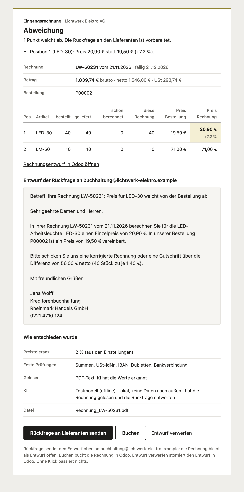
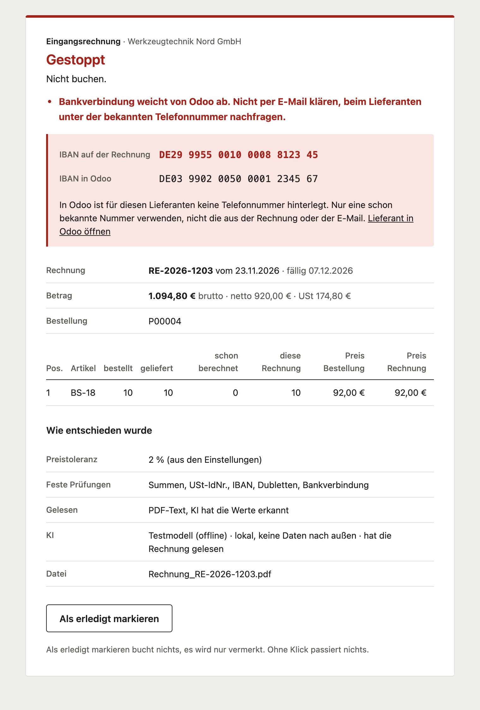
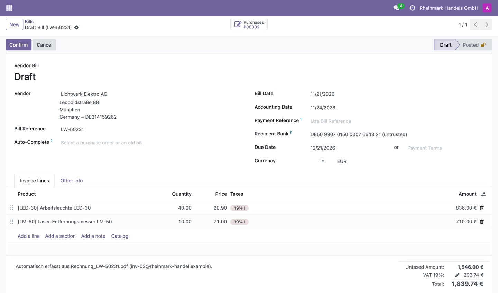

# InboxToOdoo

### Supplier invoices and customer complaints from the mailbox, checked against Odoo by fixed rules, booked after one click.

- **Problem:** small businesses type supplier invoices and customer complaints into their ERP by hand, and invoice fraud (a "new bank account") slips through.
- **What it does:** reads the e-mail, checks it against Odoo with fixed rules (3-way match, duplicates, bank account, warranty), prepares the vendor bill, credit note or replacement order as a draft, and waits for one click from a person.
- **Tested:** 12 supplier invoices and 8 complaints, end to end. In these runs the AI step was a local stand-in that returns prepared answers; Odoo, the rules, OCR, the mails and the bookings ran for real. Not yet run with a real model.
- **Built with:** Odoo 18 Community, n8n, Docker. Runs on one machine; with a local model no customer or supplier data leaves it.
- **Project by Sam Zeidi**, Information Systems student, Universität zu Köln · contact.samzeidi@gmail.com

What I designed and decided: the process (which checks run, when the automation stops, what a person has to approve), the rules and tolerances, the Odoo demo company with its orders and deliveries, the 20 test cases, and the approval mails and forms. The demo company, Rheinmark Handels GmbH, is fictional.



## Try it

Needs Docker (macOS: Docker Desktop, OrbStack or Colima) and Python 3. Clone into your home folder (Colima only shares that with containers).

```bash
git clone https://github.com/samaistudio/InboxToOdoo.git
cd InboxToOdoo
./install.sh --demo
```

The installer creates `.env.local` with fresh local passwords, starts Odoo 18, n8n, a test mailbox, OCR and the stand-in AI, creates the Odoo database `inboxtoodoo` with the fictional company (German SKR03 chart, products, customers, suppliers, sales and purchase orders), loads the workflows and, with `--demo`, mails the test complaints and invoices into the inbox. It is safe to run again; if a step fails, the details are in `install.log`.

Then open **http://localhost:8025**: the approval mails arrive within two minutes. Odoo is at http://localhost:8069 (user `admin`, password in `.env.local`). The n8n editor is at http://localhost:5678; create its owner account the first time you open it.

A product page, a walkthrough of nine real screens and a 43-second video are in `docs/` (`python3 -m http.server -d docs`, then http://localhost:8000). AI coding agents: see [AGENTS.md](AGENTS.md).

## What it checks

### Supplier invoices (Eingangsrechnungen)

A supplier e-mails an invoice. The workflow reads it, checks it with fixed rules, compares it with the purchase order and the goods receipt in Odoo (3-way match), creates a draft vendor bill and asks Accounts to approve. On a difference it drafts a query to the supplier.

```
invoice mailbox ─▶ what kind of document?
     e-invoice (XRechnung, ZUGFeRD) ─▶ Odoo's own importer reads it, no AI
     PDF with text                  ─▶ AI reads supplier, numbers, lines, totals
     scan or photo                  ─▶ OCR (Tesseract, local) ─▶ AI reads the text
   ─▶ fixed checks: line sums, net + VAT = gross, VAT ID check digit, IBAN checksum
   ─▶ Odoo: supplier, bank accounts, purchase orders, receipts, earlier invoices
   ─▶ 3-way match per line (ordered / received / already invoiced / this invoice, price tolerance)
   ─▶ stop: unknown supplier, duplicate, changed bank account
   ─▶ draft vendor bill linked to the order lines
   ─▶ AI drafts a supplier query for differences
   ─▶ approval mail: book │ send query (draft stays open) │ discard
```

| Format | Who reads it | Why |
|---|---|---|
| XRechnung (XML, UBL or CII) | Odoo itself (module `account_edi_ubl_cii`, part of Community) | the data is already structured; Odoo matches supplier, bank account and order lines on its own |
| ZUGFeRD / Factur-X (PDF with embedded XML) | Odoo itself, same module | same |
| PDF exported from accounting software | the AI, from the PDF's text | no structured data inside |
| Scanned paper or photo | Tesseract OCR in the `docreader` container, then the AI | a scan is only an image; Odoo's own OCR ("digitisation") is a paid Enterprise service |

What Odoo already does is used, not rebuilt: e-invoice import and order-line matching come from Odoo Community. The automation adds the mailbox intake, OCR for scans, the fixed checks, the fraud and duplicate stops, the supplier query and the approval step.

The AI only reads the document. Every decision comes from rules that do not depend on it: sums are recalculated, the German VAT ID check digit and the IBAN checksum are verified, and the match against Odoo is plain arithmetic. A changed bank account stops the invoice with the advice to confirm it by phone at a number already known, never by replying to the e-mail.



### Customer complaints (Reklamationen)

A complaint e-mail arrives. The workflow reads it, finds the order in Odoo, checks warranty and what went wrong, decides on replacement, credit note, refusal or a follow-up question, creates the draft in Odoo and writes the reply. A person approves with one click; only then is the draft booked and the reply sent. Every step is logged.

```
service mailbox ─▶ AI reads the e-mail ─▶ Odoo: order, items, delivery, customer
   ─▶ rules (warranty B2B/B2C, problem type, customer wish, settings)
   ─▶ draft in Odoo (replacement order or credit note)
   ─▶ AI writes the reply ─▶ style check (sent back for correction once)
   ─▶ approval mail ─▶ approve: book in Odoo + send reply │ reject: cancel draft
   ─▶ note on the order + log line
```

Every reply follows [`prompts/EMAIL_STYLE.md`](prompts/EMAIL_STYLE.md): German business e-mail practice (DIN 5008), US business e-mail conventions, and a list of phrases that make a mail sound machine-written. A code check enforces the hardest rules after the model writes.

## Tested cases

In these runs the AI step was a local stand-in that returns prepared answers (`mock-llm/fixtures/`, one file per case and task); Odoo, the rules, OCR, the mails and the bookings ran for real. So the tests show that the workflow around the AI works; they do not measure how well a real model reads invoices.

**Supplier invoices.** Eleven fictional documents: eight PDFs in three layouts (`test/make_invoices.py`), an XRechnung, a ZUGFeRD PDF and a scanned paper invoice (`test/make_einvoices.py`; simplified test files, not validated against the full standards). Case 12 sends the XRechnung a second time.

| # | Invoice | Expected verdict |
|---|---|---|
| 1 | Matches order and receipt | Buchbar: draft bill, booked after approval |
| 2 | Price 7.2 % above the order (tolerance 2 %) | Abweichung: query asks for correction or a 56.00 € credit |
| 3 | 30 invoiced, 20 received | Abweichung: query asks to invoice only the delivered quantity |
| 4 | The same invoice again, as a copy | Gestoppt: duplicate of the bill from case 1 |
| 5 | "New bank account" | Gestoppt: bank account differs from Odoo, phone check advised |
| 6 | No order number | Buchbar: matched to the only fitting open order |
| 7 | Printed total 10 € too high | Abweichung: query sent; Odoo's draft carries the correct total |
| 8 | Supplier not in Odoo | Gestoppt: supplier must be created first |
| 9 | XRechnung (XML) that matches | Buchbar: read by Odoo without AI, order line linked by Odoo |
| 10 | ZUGFeRD PDF, price 2.8 % above the order | Abweichung: read by Odoo without AI, query drafted |
| 11 | Scanned paper invoice, slightly rotated and noisy | Buchbar: OCR, then the AI, everything matched |
| 12 | The XRechnung from case 9 sent again | Gestoppt: duplicate of the posted bill |

`test/run_invoices.py` sends the cases one at a time, waits for each approval mail and compares the verdict in its subject with this table (PASS/FAIL per case, exit code 1 on any failure); `--check-only` sends nothing and checks the mails already in the inbox. An earlier run on the development machine gave the expected verdict for all twelve (its local log, `data/log.jsonl`, is not in the repository). In the run behind the screenshots the eleven invoices arrived in the same minute and were checked in parallel: `--check-only` on that inbox gives 9 of 12, because LW-50288 (case 6) found two open orders instead of one, and the original and the copy of RE-2026-1187 (cases 1 and 4) swapped roles. See Limits.

**Customer complaints** (`test/complaints.py`):

| Case | Customer | Result |
|---|---|---|
| Drill does not charge | B2B, Sie | free replacement order, confirmed after approval |
| Display cracked on arrival, wants money back | B2C | credit note 141.61 €, posted after approval |
| Wrong item delivered | B2B | replacement of the ordered item |
| Drill broken after 3 years | B2C | refused (warranty 24 months), paid repair offered |
| Flickering light | B2C, English | replacement, reply in US business English |
| Handle broke, no order number, writes "du" | B2B | order found through the sender address, replacement; rejected in approval, draft cancelled |
| Vague complaint, unknown sender | – | asks for order number, product and description |
| Two scratched safety glasses | B2B | credit note 23.56 €. The prepared first reply breaks the style rules on purpose (`test-08.reply.txt`); the style check caught it and the corrected reply was used |

Also tested: the Anthropic request format, the key taken from Odoo's settings, and both missing-key errors.

**Unit tests.** The fixed rules (IBAN checksum, VAT ID check digit, sum checks, price tolerance, quantity check, warranty, order of the remedy rules, choice of the order line, style check) live in `workflows/src/rules/` and are tested with `node --test test/rules.test.mjs` (Node 20 or newer, no packages). The same files are built into the n8n workflows.



## How it is built

| Part | Where | Purpose |
|---|---|---|
| n8n 2.49 | `localhost:5678` | the six workflows in `workflows/` |
| Odoo 18 Community + PostgreSQL 16 | `localhost:8069` | the ERP, demo company "Rheinmark Handels GmbH" |
| Mailpit | `localhost:8025` | local mail server with a web inbox (service, invoice, approval and customer mails) |
| docreader | `localhost:8098` | recognises e-invoices and reads scans with Tesseract OCR (German and English), locally |
| mock-llm | `localhost:8099` | the stand-in AI for demos and tests |

All ports are bound to 127.0.0.1. Image versions are pinned in `docker-compose.yml` to the ones the demo was tested with (Odoo 18.0-20261112, n8n 2.49.5, Mailpit 1.34.0, PostgreSQL 16).

| # | Workflow | Trigger | What it does | Nodes |
|---|---|---|---|---|
| 1 | Reklamation: Assistent | webhook | the complaint process above | 35 |
| 2 | Reklamation: Posteingang | every minute | hands new mails in the service mailbox to workflow 1 | 8 |
| 3 | Reklamation: Einstellungen | form `/form/einstellungen` | language, Sie/du, tone, length, apology, closing, signature, own rules, default remedy, warranty months, approval address, AI provider and model | 8 |
| 4 | Eingangsrechnung: Prüfung | webhook | the invoice process above | 48 |
| 5 | Eingangsrechnung: Posteingang | every minute | hands new invoice attachments to workflow 4, oldest first | 9 |
| 6 | Eingangsrechnung: Einstellungen | form `/form/rechnungen-einstellungen` | price tolerance, approval address, invoice mailbox, signature for queries | 8 |

**Code layout.** The logic of every n8n Code node is a plain JavaScript file in `workflows/src/`: `rules/` for the fixed rules, `rechnung/` and `reklamation/` for the two processes, `shared/` for the AI request and the mail layout. `build_workflows.py` and `build_eingangsrechnung.py` only wire the nodes together and write `workflows/*.json`; `./reload.sh` rebuilds them and loads them into the running n8n. A GitHub Action runs the unit tests and checks that the JSON files match their sources.

**Which AI it uses.** The company picks the AI in the settings form. Every choice uses the same prompts, rules and style check.

| Setting | What it does | Where customer data goes |
|---|---|---|
| Testmodell (offline) | the stand-in for demos and tests (default) | nowhere |
| Ollama / LM Studio (lokal) | a model on the company's own machine (default for Ollama: `qwen2.5:7b`) | nowhere |
| Wie in Odoo eingerichtet | reuses the AI key already stored in Odoo's settings (looks for `ai.openai_key`, `ai.google_key` and similar; the list is in `data/settings.json`) | to that provider |
| OpenAI, Anthropic, Google Gemini, Mistral | the provider's API | to that provider |
| Azure OpenAI | the company's own Azure deployment (EU regions possible) | to the company's Azure tenant |
| Eigener Endpunkt | any OpenAI-compatible server (vLLM, LiteLLM, …) | to that server |

API keys are never typed into the form or stored in the settings file. They live in `.env.local` on the server (see `config/env.example`); the "Odoo" option reads the key from Odoo instead. The approval mail always names the AI that was used and says whether data left the company. If a key is missing, the run stops before anything is written to Odoo.

**Day to day.** `docker compose up -d` / `docker compose down`; `./reload.sh` after changing anything in `workflows/src/` or a `build_*.py`; `python3 test/run_invoices.py` for the invoice cases; `python3 test/complaints.py` mails the complaints again. `test/reset_odoo.py` removes what the automations created:

```bash
docker compose exec -T odoo sh -c 'odoo shell -d inboxtoodoo --db_host=$HOST --db_user=$USER --db_password=$PASSWORD --no-http' < test/reset_odoo.py
```

Posted bills and credit notes are cancelled, not deleted, because Odoo's audit trail keeps them. `python3 docs/make_tutorial.py` and `python3 docs/make_video.py` retake the walkthrough screens and the video from the running demo.

## Limits

- A fictional company, tested with 12 invoices and 8 complaints. The AI step was the stand-in with prepared answers; local models and cloud keys are one setting away but have not been tested with these cases.
- Invoices that arrive in the same minute are checked in parallel, so one invoice can miss a draft bill that another creates at the same moment (see Tested cases). A real setup would process them one at a time.
- The approval buttons are signed n8n links that act on a click (HTTP GET). Mail security scanners that open links (for example Microsoft Defender Safe Links) could trigger them, and the mail does not record who clicked. A real setup would put a confirmation page with a POST behind each button and log the approver.
- Odoo's JSON-RPC answers are not checked for errors after each call yet, and the calls run as the Odoo admin. A real setup needs an integration user with only the rights it needs, an API key, and a run that stops and reports on any Odoo error.
- The bank-account stop for e-invoices treats a bank account or supplier that Odoo's importer created in the last 10 minutes as new. The same e-invoice sent again later would no longer count as new. Odoo's own trust flag on bank accounts (`allow_out_payment`) would be the better test.
- The settings forms are n8n's own form pages, and n8n's template loads the Open Sans font from Google Fonts and its icon from n8n.io. Opening a form therefore sends the viewer's IP address to Google and n8n. A reverse proxy in front of n8n can strip that link (see the next point).
- The settings forms have no login. Before a real deployment they must sit behind n8n's authentication or a reverse proxy with login, because anyone who reaches them can change the approval address.
- The seed data uses fixed dates in November 2026, so the B2B warranty cases (12 months) change their result from mid-October 2027.
- The mailbox is local. A real mailbox (IMAP, Microsoft 365, Gmail) means swapping the inbox step in n8n; the read flag would then need a list of processed message IDs.
- Built and tested on Odoo 18 Community in Docker only. Odoo.sh and Odoo Online should work through the external API but are not tested; the Odoo address comes from `ODOO_URL` and `ODOO_PUBLIC_URL` in `.env.local`.

## License

Apache-2.0, see [LICENSE](LICENSE) and [NOTICE](NOTICE). Copyright 2026 Sam Zeidi. Third-party material and the software the stack downloads are listed in [THIRD_PARTY_NOTICES.md](THIRD_PARTY_NOTICES.md); part 3 of the e-mail style guide started from [blader/humanizer](https://github.com/blader/humanizer) (MIT).

All companies, people, orders, bank accounts and phone numbers in the demo are fictional. The supplier VAT IDs are made up to pass the German check digit but have not been checked against VIES, so one could belong to a real company by chance. The phone numbers come from the range the Bundesnetzagentur keeps free for fiction, the e-mail addresses use the reserved `.example` domain, and the test IBANs use a bank-code range no German bank uses.
